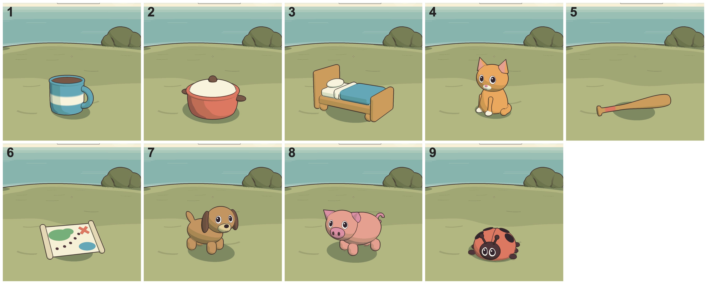

# Things

The small drawings of everyday things a word can be about: a cat, a cup, a bed. They stand in a row on
the grass in an exercise. Each is a recipe in `src/scenes/things/` that builds one merged mesh. This page
is the brief for drawing more of them. Read it, read the nine recipes that exist, then draw.

## What a thing is

A toy of the thing, not the thing and not a character. A child reads a word and picks it out of three
near misses (cat, cap, cot), so the one job of a drawing is to be named correctly at a glance, at the
size of a thumbnail, by a five-year-old. Everything below serves that.

## The rules

1. **Silhouette first.** Fill the drawing in black in your head. If it cannot be named, no detail will
   save it. Exaggerate the one feature that names it: the cat's ears, the pig's snout, the bat's taper.
2. **Chunky.** Toy proportions: thick legs, fat handles, big heads (an animal's head is about as big as
   its body). Nothing thinner than about 0.03 units, or it vanishes at play size.
3. **One thing per drawing.** A ball beside the bat makes two answers.
4. **Few parts.** Six to ten pieces is typical. If a piece cannot be seen at play size, delete it.
5. **Two or three colours and one accent**, all from `src/gfx/palette.ts`. Never `C.glow`. Nothing
   near-black bigger than a nose: `C.ink` and `C.faceInk` are for small marks, `C.trunk` is the dark for
   anything larger. Check it against the grass: pale tan and olive disappear on it.
6. **Three-quarters on.** Nothing faces the camera dead on and nothing is flat side-on. Give it a `turn`
   of 0.3 to 0.55 radians either way; vary the direction between drawings.
7. **Objects have no faces.** No eyes on a cup, ever.
8. **Animals have the creatures' eyes** (`eyes()` in `parts.ts`): white, pupil, glint, ink ring, painted
   by the face shader. Set them wide (yaw 0.4 to 0.5) and no higher than the middle of the head, at size
   0.9 to 1.35. A small or dark head needs the bigger size, or the eyes read as sockets. A smile
   (`mouth`) only where there is a pale muzzle to carry it. No eyebrows, lashes, teeth or tongues.
   Never model an eye, and never leave an animal with dots or with nothing.
9. **About half a unit tall**, and no wider than about 0.9. Sizes are toy sizes, not real ones: the cup
   is as big as the pig. Use `scale` if a recipe comes out too big beside the others.
10. **Stand on the ground.** The lowest point is at y = 0. It need not be centred: the loader puts its
   middle over the origin.
11. **Same light as everything else.** Things use the toon material; do not make materials in a recipe.

## How the lines work, and why they are crisp

Scenery is inked by the outline pass wherever the surface creases. On something as small as a thing
that gave dotted, muddy lines round every nose and spot, and rings round modelled eyes that read as
spectacles. So a thing is inked differently: **every piece of a drawing has a part number, and ink is
drawn only where two different numbers meet** (and round the silhouette). You place the lines.

- `part(n, ...pieces)` numbers pieces. Numbers run 0 to 15. Every piece needs one.
- Pieces that share a number flow into each other with no line: a pale muzzle on a head, spots on a
  shell, the stripe on the cup. Use this for anything painted on.
- Where two parts lie flush, the line is drawn on the higher number. Give the smaller or darker piece
  the higher number: a dark nose swallows its own line.
- Where one part stands in front of another, the line is on the one in front.
- If a line would be noise at play size, give both sides the same number.

Colour changes inside one piece (the cup's stripe) are painted with a colour function on a lathe with
plenty of steps; see `cup`.

## Building one

`parts.ts` has the pieces: `part`, `eyes`, `ball`, `box`, `leg`, `pointEar`, `wrapTail`, `curlTail`,
`swing`, and the colour names. `gfx/geo.ts` has `ellipsoid`, `lathe`, `capsule`, `place`, `merge`. Add a
helper to `parts.ts` the second time you need the same piece (wheels and wings are coming).

An animal is built with its **head looking down +z**, because that is the way the painted eyes look.
The body is built behind it and swung round with `swing`, so the head is turned back toward us over its
shoulder; then `turn` swings the whole animal. The eyes find the camera by themselves. `dog` and `pig`
are the pattern for anything on four legs, `cat` for anything sitting up.

A recipe returns `{ geo, face?, turn?, scale? }`. Add it to `RECIPES` in `index.ts`. Keep each file
under about 300 lines: animals in `animals.ts`, the rest in `objects.ts`, and start a new file
(`vehicles.ts`, `food.ts`, `people.ts`) when one fills.

## The approved nine



In order: cup, pot, bed, cat, bat, map, dog, pig, bug. Run the sheet to see them at play size.

| Word | What makes it read | Worth copying |
|---|---|---|
| cup | Mug with a fat handle, a cream stripe, a dark drink | Stripe painted on, not a separate piece |
| pot | Wide red body with a rim, pale domed lid, knob, two lugs | Lid a different colour from the body |
| bed | Headboard, pillow, blanket turned down, foot toward us | Turned so three faces show |
| cat | Sitting up, big head, pointed ears, tail round its feet | Muzzle and nose share the head's number |
| bat | Long taper, a band of tape on the grip, knob; no ball | Dark wood, not pale: it has to show on grass. One thing per drawing |
| map | Rolled ends, island, dotted way, red cross | Everything on the sheet is one part: no lines on the marks |
| dog | Four fat legs, hanging dark ears, pale muzzle | Body swung under a head that looks round at us |
| pig | Flat snout with nostrils, ears tipped forward, curl of a tail | Same build as the dog, facing the other way |
| bug | Red dome, centre line, four spots well in from the rim, small dark head with big eyes, stub feet | Tilted toward us so the shell is the hero |

What was wrong with the nine before them, so nobody does it again: four different inventions for eyes
(whites with a glint, bare white dots on a black head, pinpricks the size of the nostrils, dark ovals);
every eye, muzzle and nose modelled and so ringed with broken ink; animals sitting dead-on and staring;
thin legs and a thin bat; everything muted by the scene's grade so it looked like scenery.

## Looking at them

```
npm run shots -- things          # everything
npm run shots -- things hen fox  # only these
```

This writes, for tall and wide:

- `shots/things-page1-wide.png`: a page of nine at play size, in the exercise scene's clearing, light
  and camera, beside a creature. This is the one that matters.
- `shots/things-hen-wide.png`: one thing, three times closer. The name is in the file name only.
- `shots/things-numbered-wide.png`: the close-ups tiled and numbered, with no names anywhere.

If a screenshot times out, something else is using the GPU (another session running `npm run play` or
`npm run shots`): wait for it and run again.

In the dev server: `?scene=things`, `?scene=things&page=1`, `?scene=things&thing=hen`.

Look at every drawing at play size, in tall and wide, before calling it done. Check for: lines that are
broken or doubled; a part that floats or pokes through; eyes that touch a muzzle or an ear; a shadow
much bigger than the thing.

## The critic

You know what you drew, so you cannot tell whether it reads. Ask someone who does not. Give a fresh
subagent the numbered sheet and the two play-size pages, and nothing else:

> You are an art critic for a children's game (ages 4 to 7). Look at these images and nothing else.
> A. For each number: what is it, in one word a five-year-old would say? If unsure, say so and give a
> second guess. B. For each: is anything unsettling or creepy? Is any line broken, muddy, dotted or
> doubled? Is anything else a real problem? List nitpicks separately. C. Which three are weakest, and
> the single most useful change to each. Do not be polite.

Tell it which creature on the page is the resident and not one of the drawings. Fix what it finds and
ask a new one; a critic that has seen the last round is no use. Stop when every drawing is named
correctly and nothing is called unsettling. It will always name three weakest and always have
nitpicks: weigh those, do not chase them. Two critics will ask for opposite things.

A word the critic names differently is not always a bad drawing: "ladybug" for bug and "mug" for cup
are fine, because the child is choosing between three pictures, not naming one.

## Words still to draw

From the picturable nouns in `src/content/words.json` as it stood when this was written; if the list has
changed, redo this from it. Grouped so that each batch completes sets of near misses that differ by one
letter, nearest island first. Draw a batch, run the critic on it, get the owner's eye on the page.

**Batch 1** (letters of the first two islands): mat, man, pan, fan, pin, tin, fin, tap
- map · mat · man
- pan · fan · man
- pin · tin · fin
- pan · pin, map · tap

**Batch 2** (third island): cap, cot, can, dot, top, mop, cod, dad
- cat · cap · cot
- cat · cap · can
- pot · cot · dot
- top · mop · map, top · tap
- cod · cot · cap

**Batch 3** (fourth island): bud, bus, cab, cob, sun, net, nut, peg
- bed · bud · bug
- bug · bus · bud
- cab · cob · cod, cab · cap · can
- net · nut
- pig · peg · pin

**Batch 4** (fourth and fifth islands): tub, gum, mud, hat, hen, rat, log, lip
- bat · cat · hat, hat · rat · mat
- log · dog
- mud · bud
- hen · ten (if ten is ever shown), tub and gum have no near miss drawn yet

**Batch 5** (fifth island and after): kid, elk, milk, ant, nest
- net · nest; the rest stand alone and can wait

**Batch 6** (words with two consonants together): frog, crab, drum, flag, plum, sled, belt, desk, mask, hand
- None of these has a near miss that can be drawn; a child tells them apart from words that share an
  end or a start (frog · log, hand · hat, belt · bed, drum · gum, plum · gum).

Left out on purpose: ten and men (a numeral and a plural), pit, gas.

Notes for whoever draws them:

- **Pairs that must never be offered together**, because one picture answers both: can and tin; bed and
  cot; man and dad; pan and pot unless the pan has one long handle and no lid. Draw a tin as a round
  biscuit tin with its lid on, a can as a food can with a label, a cot as a baby's cot with bars.
- **People** (man, dad, kid): none exists yet. Draw them as peg dolls, a round head on a simple body,
  with the same eyes, and show the owner the first one before drawing the others.
- **Hard to picture**: dot, lip, gum, mud, fin. Try them last; if the critic cannot name one, say so
  and leave the word out instead of shipping a guess.
- A word shown as one and several (`endings.json`) must have a drawing; a test checks.
